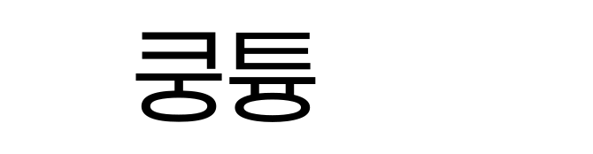
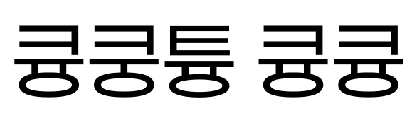

# Paperlokyung (페이퍼로큥)

[Paperlogy(페이퍼로지)](https://freesentation.blog/paperlogyfont) 1.001을 기반으로 "큥"(U+D065) 글리프를 보완한 파생 글꼴입니다. 9개 웨이트(1 Thin ~ 9 Black)를 모두 포함합니다.

| Paperlogy | Paperlokyung |
|---|---|
|  |  |

## 무엇을 고쳤나

Paperlogy는 "큥"을 cmap에 등록해 두었지만 실제 글리프는 윤곽선이 없고 폭이 1000입니다. 그래서 브라우저나 앱이 대체 폰트로 넘어가지 못하고 넓은 빈칸만 그립니다.

Paperlokyung은 폰트에 이미 있는 글자로 "큥"을 그립니다.

- **쿵**에서 ㅋ, 가로획, ㅇ 받침, 위아래 비율을 그대로 가져옵니다. ㅋ 초성일 때 폰트가 쓰는 공간 배분과 같습니다.
- **튱**(ㅇ 받침 위의 ㅠ)에서 두 다리의 x 위치를 웨이트별로 가져옵니다.
- 쿵의 ㅜ 기둥 하나를 ㅠ 다리 두 개로 바꾸고, 다리를 ㅇ 위쪽 곡선에 이어 붙입니다.

폭(792)과 세로쓰기 메트릭은 "쿵"과 같습니다. 패밀리 이름은 `Paperlokyung` / `페이퍼로큥`으로 바꿨습니다.

## 빌드

```sh
sh scripts/fetch_upstream.sh          # build/upstream 에 원본 다운로드 + SHA-256 검증
python3 scripts/build.py              # fonts/ttf/Paperlokyung-*.ttf 생성
```

`fontTools`가 필요합니다.

## 테스트 페이지

```sh
python3 -m http.server 8765          # 저장소 루트에서 실행
open http://127.0.0.1:8765/test/
```

문장을 입력하고 크기와 웨이트를 바꿔 볼 수 있습니다. "원본 Paperlogy와 비교"를 켜면 원본과 나란히 보여 줍니다. 원본 비교는 `fetch_upstream.sh`로 원본을 받은 뒤에 동작합니다.

## 알려진 한계

- 원본 Paperlogy는 한글 11,172자 중 8,392자를 "큥"과 같은 빈 글리프로 두었습니다(예: 귱, 갂, 갃). 이 저장소는 "큥"만 보완했으므로 나머지 글자는 여전히 빈칸으로 렌더링됩니다.
- TTF만 제공합니다. WOFF2는 만들지 않았습니다.

## 라이선스

SIL Open Font License 1.1. [OFL.txt](OFL.txt)를 참고하세요. 원본 저작권은 PT&(디자인 이주임, 기획 김도균)에 있습니다. Paperlogy는 Lee Juim의 상표이며, 이 파생 글꼴은 원작자와 관련이 없습니다.
