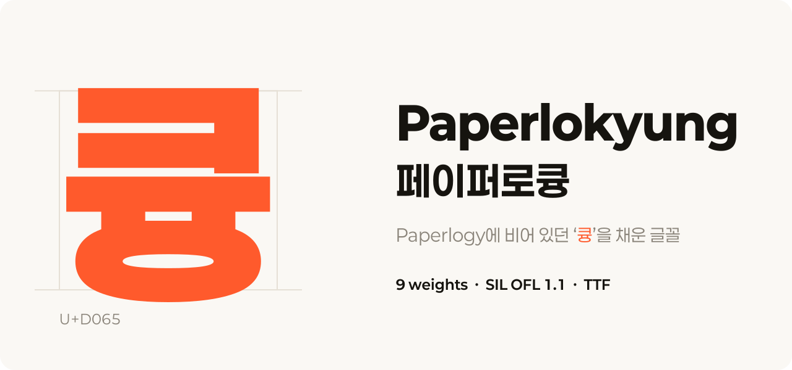
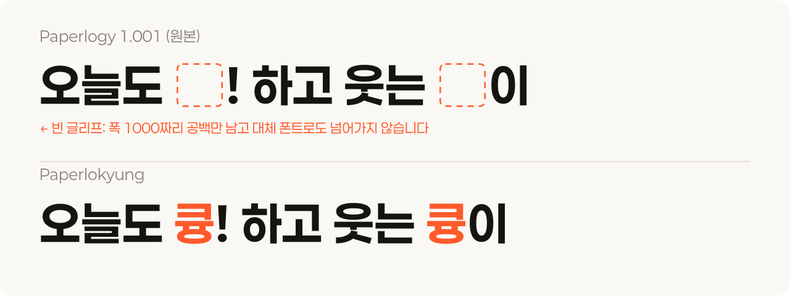
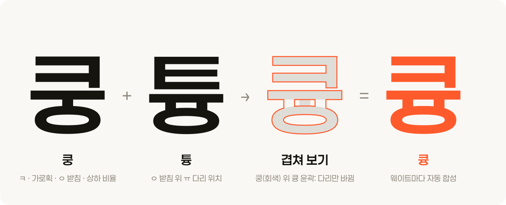
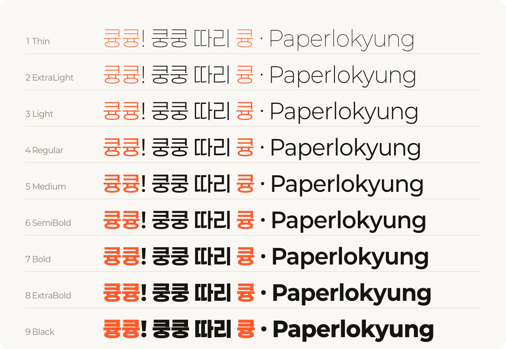

<p align="center">
  
</p>

<p align="center">
  <a href="https://github.com/AustinKimDev/paperlokyung/releases/latest"></a>
  <a href="OFL.txt"></a>
  
  
</p>

<p align="center">
  <b>Paperlogy에서 빈칸으로 나오던 ‘큥’을 폰트 안의 글자로 다시 지었습니다.</b><br>
  9개 웨이트 · 상업적 사용 가능 · SIL Open Font License 1.1
</p>

---

## 큥이 사라지는 문제



[Paperlogy(페이퍼로지)](https://freesentation.blog/paperlogyfont)는 프레젠테이션용으로 만들어진 무료 글꼴입니다. 그런데 "큥"을 입력하면 아무것도 나오지 않습니다.

- 폰트가 U+D065를 자기 글자라고 등록해 놓았지만, 실제로는 윤곽선이 하나도 없는 빈 글리프입니다.
- 등록은 되어 있으니 브라우저 같은 프로그램이 대체 폰트를 찾지 않습니다.
- 결국 다른 글자보다 넓은(폭 1000, 보통 글자는 792) 공백만 찍힙니다.

"큥큥", "큥이", "쿵큥" 같은 말을 Paperlogy로 쓸 수 없었던 이유입니다.

## 어떻게 만들었나



새로 그리지 않고 **Paperlogy가 이미 가진 글자를 조합**했습니다. 그래서 획 굵기, 곡선, 공간 배분이 원래 글자들과 같습니다.

| 재료 | 가져온 것 | 이유 |
|---|---|---|
| **쿵** (ㅋ+ㅜ+ㅇ) | ㅋ, 가로획, ㅇ 받침, 위아래 비율 | 초성이 ㅋ일 때 폰트가 쓰는 공간 배분을 그대로 따르려고 |
| **튱** (ㅌ+ㅠ+ㅇ) | ㅠ 두 다리의 가로 위치 | ㅋ과 모양이 가장 가까운 ㅌ이 ㅇ 받침 위에서 쓰는 ㅠ 간격 |

1. 쿵에서 ㅜ의 기둥 하나를 지웁니다.
2. 그 자리에 튱의 위치대로 ㅠ 다리 두 개를 세웁니다.
3. ㅇ 위쪽 곡선을 다리 위치에서 정확히 잘라(이차 베지어 분할) 다리와 매끄럽게 잇습니다.

웨이트마다 윤곽선 점 구성이 달라서, 점 번호가 아니라 곡선 구간을 기준으로 계산합니다. 다리가 ㅇ 곡선 위에 정확히 내려앉지 않으면 빌드가 멈추도록 검사도 넣었습니다. 글자 폭(792)과 세로쓰기 메트릭은 쿵과 같고, 윤곽은 겹침 없이 만들었습니다.

## 9개 웨이트



| 파일 | CSS `font-weight` |
|---|---|
| `Paperlokyung-1Thin.ttf` | 100 |
| `Paperlokyung-2ExtraLight.ttf` | 200 |
| `Paperlokyung-3Light.ttf` | 300 |
| `Paperlokyung-4Regular.ttf` | 400 |
| `Paperlokyung-5Medium.ttf` | 500 |
| `Paperlokyung-6SemiBold.ttf` | 600 |
| `Paperlokyung-7Bold.ttf` | 700 |
| `Paperlokyung-8ExtraBold.ttf` | 800 |
| `Paperlokyung-9Black.ttf` | 900 |

## 다운로드

**[최신 릴리스에서 ZIP 받기 →](https://github.com/AustinKimDev/paperlokyung/releases/latest)**

ZIP에는 TTF 9개와 라이선스(`OFL.txt`)가 들어 있습니다. 저장소의 [`fonts/ttf/`](fonts/ttf)에서 하나씩 받아도 됩니다.

## 사용법

### 컴퓨터에 설치

- **macOS**: TTF 파일을 더블클릭하고 "서체 설치"를 누릅니다.
- **Windows**: TTF 파일을 오른쪽 클릭하고 "설치"를 누릅니다.

설치하면 글꼴 목록에 `Paperlokyung` / `페이퍼로큥`으로 나옵니다. 원본 Paperlogy와 이름이 달라서 두 글꼴을 함께 설치해도 됩니다.

### 웹에서 쓰기

jsDelivr로 GitHub 저장소의 파일을 바로 불러올 수 있습니다.

```css
@font-face {
  font-family: "Paperlokyung";
  font-weight: 400;
  font-display: swap;
  src: url("https://cdn.jsdelivr.net/gh/AustinKimDev/paperlokyung@v1.0.0/fonts/ttf/Paperlokyung-4Regular.ttf") format("truetype");
}
@font-face {
  font-family: "Paperlokyung";
  font-weight: 700;
  font-display: swap;
  src: url("https://cdn.jsdelivr.net/gh/AustinKimDev/paperlokyung@v1.0.0/fonts/ttf/Paperlokyung-7Bold.ttf") format("truetype");
}

body { font-family: "Paperlokyung", sans-serif; }
```

> TTF 한 개가 약 1.3MB입니다. 실서비스에서는 필요한 글자만 남기는 서브셋이나 WOFF2 변환을 권장합니다.

#### 웹폰트(WOFF2)

`web/` 폴더에 웹용 WOFF2 9종(`Paperlokyung-1Thin.woff2` ~ `9Black.woff2`)과 `@font-face`가 담긴 `paperlokyung.css`가 있습니다. 한 개가 약 155KB입니다.

```html
<link rel="stylesheet" href="/fonts/paperlokyung.css">
```

jsDelivr에서 바로 불러올 수도 있습니다. `web/`은 v1.1.0부터 있으니 태그를 `@v1.1.0`으로 지정하세요.

```css
@font-face {
  font-family: "Paperlokyung";
  font-weight: 400;
  font-display: swap;
  src: url("https://cdn.jsdelivr.net/gh/AustinKimDev/paperlokyung@v1.1.0/web/Paperlokyung-4Regular.woff2") format("woff2");
}
```

Paperlogy는 한글 8,392자를 빈 글리프로 두고 있어서 그대로 쓰면 브라우저가 대체 폰트로 넘어가지 않고 빈칸을 그립니다. 웹 빌드에서는 이 빈 음절을 cmap에서 제거해 브라우저가 알아서 다른 폰트로 대체하도록 했습니다. 글자가 있는 2,781자(큥 포함)만 남습니다. 한자와 가나도 뺐으므로 웹 빌드에는 한글(글자가 있는 음절), 라틴, 기호만 있습니다. 한자·가나가 필요하면 TTF를 쓰세요. 다시 만들려면 `python3 scripts/web.py`를 실행하세요.

## 직접 빌드하기

```sh
sh scripts/fetch_upstream.sh   # 원본 Paperlogy 1.001 다운로드 + SHA-256 검증 → build/upstream
python3 scripts/build.py       # fonts/ttf/Paperlokyung-*.ttf 생성
python3 scripts/specimen.py    # README 이미지(docs/*.svg) 생성
```

[fontTools](https://github.com/fonttools/fonttools)가 필요합니다.

### 테스트 페이지

```sh
python3 -m http.server 8765    # 저장소 루트에서 실행
open http://127.0.0.1:8765/test/
```

문장을 입력하고 크기와 웨이트를 바꿔 볼 수 있습니다. "원본 Paperlogy와 비교"를 켜면 원본과 나란히 보여 줍니다(원본 비교는 `fetch_upstream.sh` 실행 후 동작).

## 알려진 한계

- **원본 Paperlogy는 한글 11,172자 중 8,392자가 큥처럼 빈 글리프입니다.** 귱, 갂, 갃 같은 글자가 여기에 속합니다. 이 프로젝트는 그중 "큥"만 채웠으므로 나머지는 여전히 빈칸으로 나옵니다.
- 릴리스 ZIP에는 TTF만 들어 있습니다. 웹용 WOFF2는 저장소의 [`web/`](web) 폴더에 있습니다.

## 라이선스와 크레딧

[SIL Open Font License 1.1](OFL.txt)을 따릅니다. 자유롭게 쓰고, 고치고, 다시 배포할 수 있습니다. 글꼴 파일만 따로 판매하는 것은 금지됩니다.

- **Paperlogy** © 2024 PT&: 리디자인 이주임, 기획 김도균, 한글 G마켓산스, 라틴 Montserrat
- **Paperlokyung**: Paperlogy 1.001에 "큥"(U+D065)을 보완한 파생 글꼴

Paperlogy는 Lee Juim의 상표입니다. 이 프로젝트는 비공식 파생작이며 원작자와 관련이 없습니다.

---

<details>
<summary><b>English</b></summary>

**Paperlokyung** is a derivative of [Paperlogy](https://freesentation.blog/paperlogyfont) 1.001, a free Korean typeface. Paperlogy maps the syllable 큥 (U+D065) to an empty glyph with a 1000-unit advance, so it renders as a wide blank and never falls back to another font.

Paperlokyung draws 큥 for all nine weights from glyphs Paperlogy already has. It keeps ㅋ, the vowel bar, the ㅇ final and the vertical proportions from 쿵, and places the ㅠ legs where 튱 puts them, splitting the ring's top curves where the legs meet them. The family is renamed to avoid clashing with the original. Released under the SIL Open Font License 1.1.

Note: the upstream font leaves 8,392 of the 11,172 Hangul syllables empty; only 큥 is fixed here.

</details>
